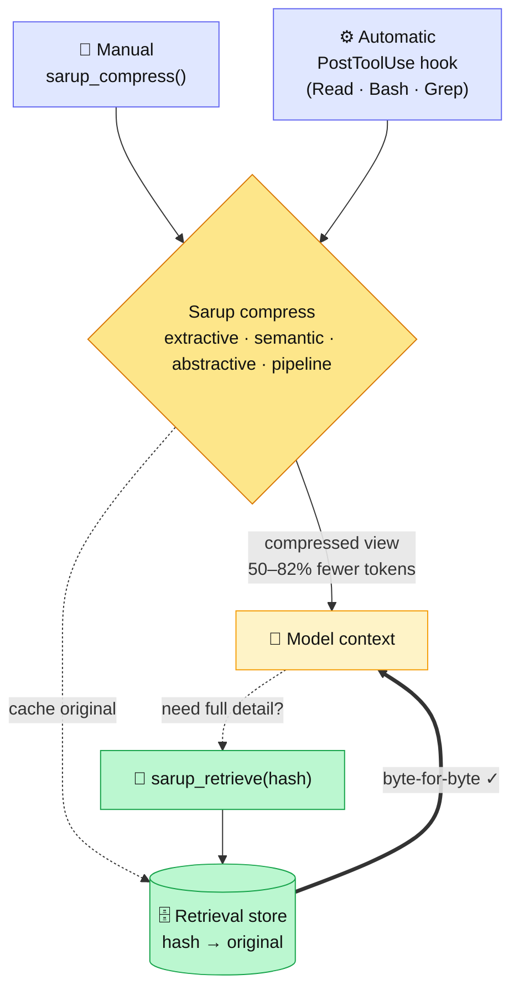

<div align="center">

# สรุป · Sarup

**Thai-first context compression for Claude Code.**
An MCP server that actually shrinks Thai (50–82% fewer tokens) and caches every original
so nothing is ever lost. Measured for what matters too: whether Claude still answers correctly.

[](https://github.com/PHUICMT/sarup/actions/workflows/ci.yml)
&nbsp;
&nbsp;
&nbsp;
&nbsp;

<!--
Quickstart demo GIF goes here. To record one:
  1) asciinema rec demo.cast      (or: terminalizer record demo)
  2) agg demo.cast docs/quickstart.gif   (asciinema -> gif)
  3) uncomment the line below and commit docs/quickstart.gif
-->
<!--  -->

</div>

> *สรุป* means "to summarize." Headroom routes Thai through `noop` (0% savings) because its
> whitespace tokenizer can't find Thai word boundaries. Sarup uses PyThaiNLP segmentation, so it
> compresses Thai as well as English — and caches every original so nothing is ever lost.

## Contents

- [Highlights](#highlights)
- [Why it&#39;s safe — the two-tier guarantee](#why-its-safe--the-two-tier-guarantee)
- [How it works](#how-it-works)
- [Tools](#tools)
- [Compression modes](#compression-modes)
- [Measured results](#measured-results)
- [Example](#example)
- [Install](#install)
- [Register with Claude Code](#register-with-claude-code)
- [Auto-compression hook](#auto-compression-hook)
- [Privacy &amp; data](#privacy--data)
- [Configuration](#configuration)
- [Project structure](#project-structure)
- [Tech stack &amp; techniques](#tech-stack--techniques)
- [Testing](#testing)
- [Roadmap](#roadmap)
- [License](#license)

## Highlights

- 🇹🇭 **Real Thai compression** — PyThaiNLP `newmm` word segmentation, not whitespace.
- ♻️ **Lossless by guarantee** — every compress caches the original; `verified: true` proves a byte-for-byte round-trip.
- 🎚️ **Five modes**: from offline 1 ms TF-IDF to an 82%-savings cascade.
- 🧠 **Optional local LLM** — embeddings + rewrite via Ollama, with automatic offline fallback.
- 📏 **Honest metrics**: a real tokenizer (tiktoken) at runtime; Claude's own tokenizer and a
  Thai QA eval for the published numbers ([Does Claude still get it right?](#does-claude-still-get-it-right)).
- 🕳️ **Visible gaps**: `[…]` marks every place sentences were dropped, so Claude retrieves
  instead of mistaking a nearby fact for the answer.
- 🔌 **Content-aware** — JSON compaction, log dedup, and verbatim code-fence preservation built in.
- 🛟 **Can't break Claude** — it's an MCP tool, not an API proxy; if the server is down the tools just go away and Claude keeps working.

## Why it's safe — the two-tier guarantee

| Tier                      | What                                 | Guarantee               |
| ------------------------- | ------------------------------------ | ----------------------- |
| **Compressed view** | the shrunk text the model works on   | lossy · small · cheap |
| **Retrieval store** | the original, keyed by a stable hash | lossless · recoverable |

Aggressive lossy compression is safe *because* the original is always one `sarup_retrieve(hash)`
away. This is how "maximum savings" and "100% accuracy" coexist — they live in different tiers.

## How it works

Two entry points feed one engine: a cheap **compressed view** the model reads, and a lossless
**retrieval store** that can restore the original byte-for-byte.



- **Manual** — the model calls `sarup_compress` / `sarup_retrieve` itself.
- **Automatic** — the hook intercepts large tool outputs, caches the original to `SARUP_DB_PATH`,
  and substitutes the compressed view + a retrieval hash. Source code is skipped; small outputs
  pass through untouched.

## Tools

| Tool                                                                 | Purpose                                                                                |
| -------------------------------------------------------------------- | -------------------------------------------------------------------------------------- |
| `sarup_compress(content, target_ratio?, lossless?, query?, mode?)` | Compress; returns compressed text, hash, token metrics,`verified`, `token_method`. |
| `sarup_retrieve(hash)`                                             | Recover the original content byte-for-byte.                                            |
| `sarup_stats()`                                                    | Cumulative session savings.                                                            |

**`sarup_compress` arguments**

| Arg              | Type    | Default        | Meaning                                                     |
| ---------------- | ------- | -------------- | ----------------------------------------------------------- |
| `content`      | string  | —             | Text to compress (required).                                |
| `target_ratio` | number  | `0.5`        | Fraction of prose to keep (0.1–0.9).                       |
| `lossless`     | boolean | `false`      | Only apply lossless transforms (whitespace / JSON compact). |
| `query`        | string  | `""`         | What you need from the text; sentences matching it are kept. Pass it whenever you know: it took the QA eval from 69% to 100% at the same size. |
| `mode`         | string  | `extractive` | See modes below.                                            |

## Compression modes

| Mode                         | How                                       | Needs Ollama |    Savings¹    | Speed¹ | Output          |
| ---------------------------- | ----------------------------------------- | :----------: | :-------------: | :------: | --------------- |
| `extractive` *(default)* | TF-IDF scoring + fact boost + n-gram dedup |      no      |      52.7%      |  ~1 ms  | verbatim subset |
| `semantic`                 | Embedding centrality + cosine dedup       |     yes     |      63.8%      | ~2 s | verbatim subset |
| `abstractive`              | Local-LLM rewrite                         |     yes     |      51.7%      | ~3–12 s | paraphrased     |
| `pipeline`                 | Cascade: semantic → abstractive          |     yes     | **82.2%** |  ~5 s   | paraphrased     |
| `auto`                     | semantic if Ollama is up, else extractive |   optional   |      63.8%      |  ~2 s  | subset          |

¹ Measured on a 10-sentence Thai paragraph (522 tokens), rewrite model `gemma4:e4b`. Every mode
stays 100% recoverable via the store; Ollama modes **degrade gracefully** to extractive when the
backend is down. (June 2026, `gemma3:12b`: pipeline 88.1%.)

Extractive and semantic output is a verbatim subset of the input sentences, with `[…]` on its
own line wherever sentences were dropped. Sentences carrying specifics (numbers, Thai digits,
identifiers like `X-Api-Key`) score higher than general statements, since those are what
questions ask about.

## Measured results

```text
$ .\.venv\Scripts\python.exe bench\benchmark.py

sample                      before   after   savings   verify
Thai prose                     522     247    52.7%       OK
Thai prose (aggressive)        522     189    63.8%       OK
English prose                  105      60    42.9%       OK
JSON (lossless)                 67      44    34.3%       OK
Logs                           563     300    46.7%       OK
TOTAL                         1779     840    52.8%    ALL OK   → 100% recoverable

Mode comparison (Thai prose, 522 tok):
  extractive 52.7% (1ms) · semantic 63.8% (2.1s) · auto 63.8% (2.1s)
  abstractive 51.7% (2.7s) · pipeline 82.2% (4.5s)      ← gemma4:e4b
```

Token counts via tiktoken `cl100k_base`. That is OpenAI's tokenizer and undercounts Claude,
most of all on Thai; `bench\benchmark.py --claude` adds a column from Claude's own tokenizer
(Anthropic `count_tokens`, needs an API key).

### Does Claude still get it right?

Fewer tokens only help if the facts survive. `bench\eval_qa.py` compresses 8 Thai documents
(incident report, meeting notes, API docs, HR policy, product spec, support chat, README, sales
report; half line-per-sentence, half dense paragraphs) and asks Claude Opus 5.5 32 questions
from the compressed view alone, graded deterministically:

```text
$ .\.venv\Scripts\python.exe bench\eval_qa.py        # uses your local `claude` login

mode               claude tok   saved  correct  abstain  wrong
──────────────────────────────────────────────────────────────
original                 4601    0.0%     100%       0%      0
extractive:0.5           3204   30.4%      69%      31%      0
extractive:0.3           1969   57.2%      44%      56%      0
semantic:0.5             3214   30.1%      62%      38%      0
extractive:0.5+q         3207   30.3%     100%       0%      0
abstractive:0.5          2697   41.6%      91%       9%      0     ← gemma4:12b
pipeline:0.5             1854   59.8%      59%      41%      0     ← gemma4:12b
```

(`gemma4:e4b` scored the same: abstractive 91%, pipeline 59%, wrong 0.)

- **wrong = 0** is the safety property: when a fact was dropped, Claude said so (*abstain*) and
  in real use would call `sarup_retrieve`. It did not guess from what was left.
- **abstain** is the real cost of blind compression: about a third of specific questions need a
  retrieval round-trip at `0.5`. Know what you're looking for? Pass it as `query` (`+q` row).
- **abstractive** keeps the most facts per token (91% at 42% saved) because a rewrite can keep
  every number while dropping words; extraction can only drop whole sentences. It costs seconds
  per document, so use it through `sarup_compress`, not the hook.
- In both evals no paraphrase changed a fact into a wrong one, but 8 documents can't prove a
  rewrite never will, which is why the original stays one `sarup_retrieve` away.
- Token counts here are Claude's own (from the answer calls' usage) and include the ~40-token
  `[sarup: …]` footer, which weighs heavily on these short (~570-token) documents and fades on
  the large outputs the hook actually compresses.
- 8 documents is a small sample; differences of a couple of questions between modes are noise.

Before the fixes this eval drove (Oct 2026): dense Thai paragraphs were not compressed at all
(the sentence splitter's model wasn't installed), `extractive:0.5` answered 59% with one
confident wrong answer, and `semantic:0.5` 47%.

## Example

A real `sarup_compress` call on a Thai paragraph (`mode="auto"`, Ollama up → semantic):

```jsonc
// → sarup_compress(content="…518-token Thai paragraph…", mode="auto")
{
  "compressed": "จุดเด่นที่สำคัญที่สุดคือมันไม่มีทางทำให้ Claude พัง…",
  "hash": "caa568140bec0ff734937cf5",
  "original_tokens": 518,
  "compressed_tokens": 154,
  "tokens_saved": 364,
  "savings_percent": 70.3,
  "transforms": ["semantic_extractive", "embeddings", "thai"],
  "lossy": true,
  "verified": true,                    // round-trip proven byte-for-byte
  "token_method": "tiktoken:cl100k_base"
}
```

The model keeps working on the 154-token view; the full 518-token original is one call away:

```jsonc
// → sarup_retrieve(hash="caa568140bec0ff734937cf5")
{ "content": "…the exact original text, restored byte-for-byte…" }
```

## Install

### As a Claude Code plugin (easiest)

Needs [uv](https://docs.astral.sh/uv/): the plugin runs Sarup through `uvx`, which fetches
Python and the dependencies on first use. Nothing to clone. In Claude Code:

```text
/plugin marketplace add PHUICMT/sarup
/plugin install sarup@sarup
```

That installs the MCP server, the auto-compression hook and the `/sarup:sarup-setup` skill.
The cache lives in the plugin's data directory, so it survives plugin updates. The first start
takes a few seconds while `uvx` builds the environment. From a shell instead:
`claude plugin marketplace add PHUICMT/sarup`, then `claude plugin install sarup@sarup`.

Ollama is optional. Without it everything works offline: the hook and the default
`extractive` mode never touch it, and asking for `semantic`, `abstractive` or `pipeline`
quietly falls back to extractive (the result's `transforms` say which ran). Install
[Ollama](https://ollama.com) and the models below only if you want those modes.

### From a clone

**One command** (creates the venv, installs everything, registers the MCP server
for all projects, idempotent):

```powershell
.\scripts\setup.ps1 -All      # Windows  (-All also adds the hook, the /sarup-setup skill, pulls Ollama models)
./scripts/setup.sh --all      # Linux / WSL / macOS
```

> Tip: `-All`/`--all` installs a global **`/sarup-setup`** skill, so on any other
> machine you can just type `/sarup-setup` in Claude Code and it walks through the
> install. (Or run `scripts/install-skill.ps1` / `install-skill.sh` on its own.)

Uninstall just as cleanly (only removes what Sarup added; `-Purge`/`--purge` also
deletes the venv + cache):

```powershell
.\scripts\uninstall.ps1       # Windows
./scripts/uninstall.sh        # Linux / WSL / macOS
```

<details><summary>Manual install</summary>

```powershell
py -3.11 -m venv .venv
.\.venv\Scripts\python.exe -m pip install -e ".[dev]"
```

</details>

Optional local-LLM modes (`semantic` / `abstractive` / `pipeline`) need [Ollama](https://ollama.com):

```powershell
ollama pull nomic-embed-text     # embeddings → semantic mode
ollama pull gemma4:e4b           # rewrite → abstractive / pipeline (or gemma4:12b / gemma3:12b)
```

## Register with Claude Code

**One-command setup (recommended).** Detects this machine's paths, probes Ollama
(picks the best mode + models), and merges into `.mcp.json` / `.claude/settings.json`
**without clobbering** anything already there (a `.bak` is written first):

```powershell
.\.venv\Scripts\python.exe scripts\install.py --with-hook --pull
```

- No Ollama? It configures offline `extractive` mode — still fully works.
- Ollama up? It auto-selects `nomic-embed-text` (semantic) + the best installed rewrite model
  (`gemma4:e4b` → `gemma4:12b` → `gemma3:12b` → `qwen3`) for `sarup_compress`.
  The hook stays `extractive` either way (it runs on every tool call). `--pull` fetches
  any missing models.
- Idempotent — safe to re-run; `--global` writes to `~/.claude` instead.

**Manual** — or add it yourself to your MCP config (e.g. `.mcp.json` or `~/.claude.json`).
Replace `<SARUP_DIR>` with the absolute path where you cloned this repo (the installer
above fills these in for you):

```json
{
  "mcpServers": {
    "sarup": {
      "command": "<SARUP_DIR>/.venv/Scripts/python.exe",
      "args": ["-m", "sarup.server"],
      "env": { "SARUP_DB_PATH": "<SARUP_DIR>/.sarup-cache.db" }
    }
  }
}
```

> On Linux/macOS the interpreter is `<SARUP_DIR>/.venv/bin/python`.

Or run it directly over stdio:

```powershell
.\.venv\Scripts\python.exe -m sarup.server
```

## Auto-compression hook

Skip manual tool calls entirely: install the **PostToolUse hook** and large `Read`/`Bash`/`Grep`
outputs are compressed before they enter context, with the original cached for retrieval.
Source-code reads are skipped for safety. Full setup in **[hooks/README.md](hooks/README.md)**.

> **Fixed in October 2026.** Earlier versions returned the compressed text as a plain string.
> Claude Code only accepts `updatedToolOutput` in the tool's own shape (`{stdout, stderr, …}`
> for Bash, `{type, file: {content, …}}` for Read) and silently dropped the string, so the hook
> never applied on any surface. It now keeps each tool's shape; verified on the CLI (2.1.289):
> the model receives the compressed view and the retrieval hash. To see what the hook does on
> your build, set `SARUP_HOOK_LOG` to a file path (one JSON line per call).

The plugin wires this up for you. From a clone, replace `<SARUP_DIR>` with your clone path, or
run `install.py --with-hook`:

```json
{
  "hooks": {
    "PostToolUse": [
      { "matcher": "Read|Bash|Grep",
        "hooks": [{ "type": "command",
          "command": "<SARUP_DIR>/.venv/Scripts/sarup-hook --db <SARUP_DIR>/.sarup-cache.db" }] }
    ]
  }
}
```

## Privacy & data

To guarantee recovery, Sarup caches the **original** content in the store. Two
things to know:

- With `SARUP_DB_PATH` set, originals are written to that **SQLite file in
  plaintext** (no encryption). Treat it like a cache of whatever you compressed.
- If you compress tool outputs that contain secrets (e.g. a `.env` dump or
  credentials in a log), those land in the cache too. The auto-hook skips
  source-code/config file reads, but `Bash` output is fair game — review what
  you point it at.

`*.db` is git-ignored, so the cache never gets committed. For zero on-disk
footprint, leave `SARUP_DB_PATH` unset (memory-only; the MCP server then loses
the cache on restart, and the hook will not substitute — see the hook docs).

## Configuration

| Var                         | Default                    | Meaning                                                                                  |
| --------------------------- | -------------------------- | ---------------------------------------------------------------------------------------- |
| `SARUP_DB_PATH`           | *(in-memory)*            | SQLite path for a persistent, cross-process store.**Required** for hook retrieval. |
| `OLLAMA_HOST`             | `http://localhost:11434` | Ollama endpoint.                                                                         |
| `SARUP_ABSTRACTIVE_MODEL` | best installed           | Model for abstractive / pipeline rewrite. Unset: first installed of `gemma4:e4b`, `gemma4:12b`, `gemma3:12b`, `qwen3`. |
| `SARUP_EMBED_MODEL`       | `nomic-embed-text`       | Model for semantic embeddings.                                                           |
| `SARUP_HOOK_MODE`         | `extractive`             | Hook compression mode. `auto`/`semantic` need Ollama and cost ~2 s per tool call.        |
| `SARUP_HOOK_MIN_TOKENS`   | `400`                    | Hook only compresses outputs with at least this many tokens (token-based, fair across languages). |
| `SARUP_HOOK_LOG`          | *(off)*                  | File to append one JSON line per hook call (event, tool, size, substituted).             |

## Project structure

```text
sarup/
├── src/sarup/
│   ├── server.py       # MCP stdio server — 3 tools
│   ├── compressor.py   # router + modes (extractive/semantic/abstractive/pipeline/auto)
│   ├── thai.py         # PyThaiNLP tokenization, sentence split, TF-IDF
│   ├── semantic.py     # embedding centrality + cosine dedup
│   ├── llm.py          # optional Ollama backend (generate + embed)
│   ├── tokens.py       # real token counting (tiktoken)
│   └── store.py        # CCR store: hash → original (memory + SQLite)
├── hooks/
│   ├── sarup_hook.py   # PostToolUse auto-compression hook
│   └── README.md       # hook install guide
├── bench/benchmark.py  # before/after measurement
├── tests/              # test_thai, test_mcp, test_hook, ...
├── README.md
└── STACK.md            # full stack + techniques
```

## Tech stack & techniques

Python 3.11 · MCP · PyThaiNLP `newmm` · tiktoken · Ollama (optional) · SQLite · hatchling · pytest.

The technique behind each mode — TF-IDF scoring, embedding centrality, cascade pipeline, content
routing, and graceful degradation — is documented in **[STACK.md](STACK.md)**.

## Testing

```powershell
.\.venv\Scripts\python.exe -m pytest tests/ -q
```

The suite covers Thai NLP, the MCP tool contracts, every mode (including Ollama-fallback paths), the
roundtrip-verify guarantee, and the auto-compression hook (incl. cross-process retrieval).

Quality is measured separately, since it needs a model: `bench\eval_qa.py` (see
[Does Claude still get it right?](#does-claude-still-get-it-right)). It runs on the local
`claude` CLI by default, or `--backend api` with an Anthropic API key; `--dry-run` and
`--limit` keep a check cheap; a full run is ~170 Claude calls.

## Roadmap

- [ ] Grow the QA eval past 8 documents (long tool outputs, logs, mixed code) before
      changing defaults such as `auto` → semantic on the strength of it.
- [ ] Move to `mcp` 2.x (pinned `<2` for now: 2.x dropped `Server.list_tools`).
- [ ] Optional Typhoon 2.1 abstractive (blocked on an Ollama template fix).
- [ ] Per-content adaptive `target_ratio`.
- [ ] Published PyPI package.

## License

MIT
