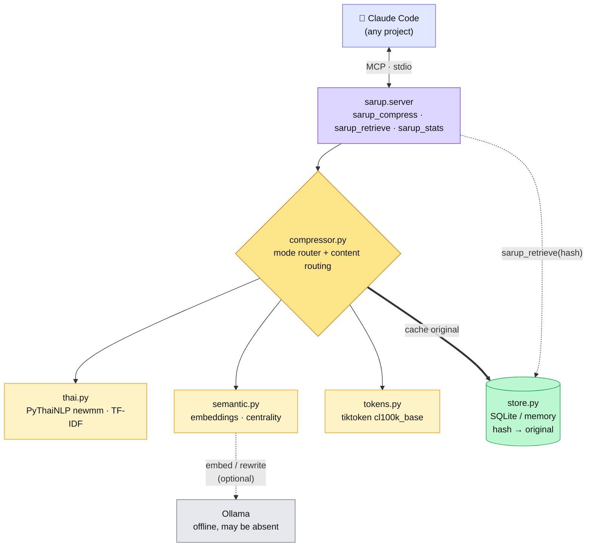
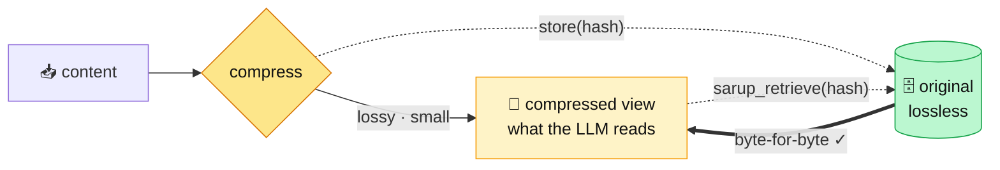

# Stack & Techniques

What Sarup is built from, and the technique behind each part.

## Tech stack

| Layer | Choice | Why |
|-------|--------|-----|
| Language | Python 3.11+ | PyThaiNLP ecosystem; MCP SDK |
| Protocol | [MCP](https://modelcontextprotocol.io) (`mcp>=1.9`, stdio) | Native Claude Code tool integration |
| Thai NLP | [PyThaiNLP](https://pythainlp.org) `newmm` | Word segmentation — Thai has no spaces between words |
| Token counting | [tiktoken](https://github.com/openai/tiktoken) `cl100k_base` | Real tokenizer (offline) at runtime; published numbers use Claude's own (`count_tokens` / CLI usage) |
| Thai sentences | PyThaiNLP `crfcut` + `python-crfsuite` | Dense Thai paragraphs have no sentence punctuation |
| Local LLM (optional) | [Ollama](https://ollama.com) via stdlib `urllib` | Embeddings + abstractive rewrite, fully offline, no extra dep |
| Embeddings | `nomic-embed-text` | Semantic sentence scoring & dedup |
| Abstractive model | best installed of `gemma4:e4b` → `gemma4:12b` → `gemma3:12b` → `qwen3` | 91% on the Thai QA eval (gemma4, thinking off); `SARUP_ABSTRACTIVE_MODEL` overrides |
| Storage | in-memory dict + optional SQLite | CCR (compress-and-cache-retrieval) original store |
| Hash | SHA-256, first 24 hex chars | Deterministic, stable content key |
| Build | hatchling | Simple PEP 621 packaging |
| Tests | pytest + pytest-asyncio | all modes incl. Ollama-fallback paths |

## System architecture

How the pieces fit — Sarup is a plain MCP stdio server, so it plugs into Claude Code as
tools and never sits in the API request path:

If the server or Ollama is unavailable, Claude Code is unaffected — the tools simply
go away (server) or compression falls back to the offline path (Ollama).

## Core architecture: two-tier guarantee

The single idea that makes "max savings + 100% accuracy" possible:

Lossy compression is *safe* because the original is always one hash lookup away.
Every compress call runs `store.verify(hash, original)` and reports
`verified: true` — the guarantee is proven per call, not assumed.

## Techniques per compression mode

### 1. Extractive (default, offline, deterministic)
- **Sentence splitting**: one per line when the text has lines; dense Thai
  paragraphs go through PyThaiNLP `crfcut` (needs `python-crfsuite`), long
  sentences sub-split before a clause connector ("and", "but", "by" …).
- **Word tokenization** via PyThaiNLP `newmm` (Thai) / whitespace (English).
- **TF-IDF sentence scoring** — rank sentences by term importance.
- **Fact boost** (×1.35 per number/identifier, up to 3): specifics are what
  questions ask about.
- **Query boost** (×2.5) — sentences matching an optional `query` score higher.
- **Position bias** — first/last sentences kept (framing).
- **n-gram (2-gram) Jaccard dedup** — drop near-duplicate sentences.
- Output is a **verbatim subset** of input sentences (no paraphrase), with `[…]`
  wherever sentences were dropped.

### 2. Semantic (Ollama, higher ratio, keeps fewer facts)
- **Sentence embeddings** (`nomic-embed-text`).
- **Centrality scoring** — each sentence ranked by mean cosine similarity to all
  others (most representative kept).
- **Cosine dedup** — catches paraphrased repetition that n-grams miss.
- Same fact boost and `[…]` gap markers as extractive.
- Output is still a **verbatim subset** — ranks by *meaning*, not word overlap.

### 3. Abstractive (Ollama, slow)
- **Local-LLM rewrite** with a strict "preserve all facts, add nothing" prompt
  (Thai or English variant chosen by content).
- Ollama `think: false` (gemma4/qwen3 otherwise reason first: 3–4× slower);
  any `<think>` blocks that still appear are stripped.
- Accepted only if it genuinely reduces tokens; otherwise falls back.

### 4. Pipeline (Ollama, maximum savings)
- **Cascade**: stage 1 selects the most representative sentences (semantic, or
  TF-IDF if embeddings are down); stage 2 abstractively rewrites the survivors.
- Each stage feeds the next → 82% on Thai prose with `gemma4:e4b` (522→93
  tokens; 88% with `gemma3:12b` in June 2026).
- Lossy view, but still fully recoverable: the original is cached before any
  stage runs.

### auto
- Prefers **semantic** when Ollama is up (best ratio for the speed), else
  **extractive** offline. The sensible everyday default for the hook.

### Content routing (before mode applies)
| Detected | Handling | Lossless? |
|----------|----------|:---:|
| JSON | compact (strip insignificant whitespace) | ✅ |
| Logs | dedup repeated lines + head-truncate | ❌ |
| Prose + code fences | compress prose, **preserve code verbatim** | code: ✅ |
| Pure prose | selected mode | subset / paraphrase |

## Graceful degradation
`abstractive → semantic → extractive`. If Ollama is down or a model is missing,
Sarup silently falls back to the deterministic offline path. It always works
offline; Ollama only raises the ceiling.

## Notes from model evaluation (June 2026)
- **Typhoon 2.1** (SCB10X, Thai-tuned) is the strongest Thai base in principle,
  but its current GGUF chat template crashes `llama-server` in recent Ollama
  (`unknown test 'tool_calls'`) — unusable until repackaged.
- **Qwen3** tends to "overthink" (slower, conservative compression) — matches
  SCB10X's own published observation.
- **Gemma 3 12B** was the validated balance for Thai (gemma4 variants compressed
  *less* in that bakeoff: 30–36% vs gemma3's 51%).

## Notes from the QA eval (October 2026)
`bench/eval_qa.py`: 8 Thai documents, 32 questions, Claude Opus 5.5 answering from
the compressed view only (full table in the README).
- The June gemma4 numbers were thinking-on runs. With `think: false`, gemma4 is
  3–4× faster and compresses 44–52% → **gemma4 is now first** in the model
  preference (`e4b`, then `12b`; both scored 91% on abstractive).
- **Abstractive keeps the most facts per token** (91% correct at 42% saved vs
  extractive's 69% at 30%): a rewrite keeps every number and drops words, while
  extraction can only drop whole sentences.
- **Semantic did not beat extractive on facts** (62% vs 69% at the same size),
  though 2 questions out of 32 is within noise. `auto` stays as is until the eval grows.
- **`query` closes the gap**: extractive with the question as `query` answered 100%.
- No mode produced a wrong answer after `[…]` gap markers were added; before them
  Claude once read "12 days" off a surviving sentence when the "15 days" one was gone.
